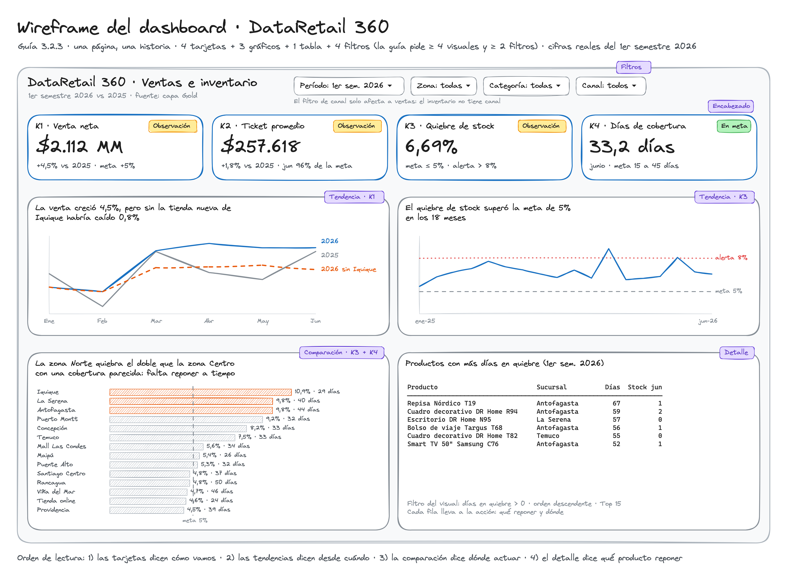

# Dashboard BI · DataRetail 360 (guía 3.2.3)

Guía para construir el dashboard en la herramienta BI a partir de nuestra capa Gold. La actividad pide
**al menos 4 visuales y 2 filtros**; este diseño usa 4 tarjetas, 3 gráficos, 1 tabla de detalle y
4 filtros, y cuenta **la misma historia** que la actividad 3.2 (`notebooks/3.2_storytelling_ventas_inventario.ipynb`).



## 0. Herramienta

Usamos **Power BI**, la herramienta que elegimos en la EP1 y que la EP3 deja como siguiente paso.
Power BI Desktop solo funciona en **Windows**: en Mac, usen un PC del laboratorio o una máquina virtual.
Si no hay Windows disponible, la sección 8 explica cómo hacerlo en **Looker Studio**, que funciona en el
navegador. Elijan una sola herramienta para todo el equipo.

## 1. Preparar los datos

```bash
python -m src.pipeline --todo --reiniciar   # solo si Gold no existe o cambió
python -m src.exportar_bi
```

| Carpeta | Archivo | Filas | Para qué |
|---|---|---|---|
| `data/bi/powerbi/` | `dim_fecha.csv` | 730 | Calendario 2025-2026 |
| | `dim_producto.csv` | 154 | Producto (SCD 1 y 3) |
| | `dim_sucursal.csv` | 14 | Sucursal (SCD 1) |
| | `dim_cliente.csv` | 1.760 | Cliente seudonimizado (SCD 2) |
| | `dim_canal.csv` | 3 | Canal |
| | `fact_ventas.csv` | 41.053 | Hecho Ventas → K1 y K2 |
| | `fact_inventario.csv` | 1.060.680 | Hecho Inventario → K3 y K4 |
| `data/bi/looker/` | `ventas.csv` | 41.053 | Ventas en una sola tabla (Looker no usa relaciones) |
| | `inventario_mensual.csv` | 714 | K3 y K4 por mes, sucursal y categoría |
| | `quiebre_productos.csv` | 35.032 | Tabla de detalle: producto x sucursal x mes |

Las columnas de linaje (`id_carga`, `archivo_origen`, `fila_origen`) se quedan en Gold: el dashboard no las usa.

## 2. Cargar y modelar en Power BI

1. **Obtener datos → Texto/CSV** y cargar los 7 archivos de `data/bi/powerbi/`.
2. En **Transformar datos** (Power Query), revisar los tipos:
    - `dim_fecha[fecha]` → **Fecha**.
    - Columnas `sk_*` → **Número entero**.
    - `dim_sucursal[latitud]` y `[longitud]` → *Cambiar tipo → Usar configuración regional →
     Decimal, Inglés (Estados Unidos)*, porque vienen con punto decimal.
3. En la **vista Modelo**, crear las relaciones (todas *varios a uno*, filtro en una sola dirección):

    | Desde (hecho) | Hacia (dimensión) |
    |---|---|
    | `fact_ventas[sk_fecha]` | `dim_fecha[sk_fecha]` |
    | `fact_ventas[sk_producto]` | `dim_producto[sk_producto]` |
    | `fact_ventas[sk_sucursal]` | `dim_sucursal[sk_sucursal]` |
    | `fact_ventas[sk_cliente]` | `dim_cliente[sk_cliente]` |
    | `fact_ventas[sk_canal]` | `dim_canal[sk_canal]` |
    | `fact_inventario[sk_fecha]` | `dim_fecha[sk_fecha]` |
    | `fact_inventario[sk_producto]` | `dim_producto[sk_producto]` |
    | `fact_inventario[sk_sucursal]` | `dim_sucursal[sk_sucursal]` |

    Los dos hechos **no se relacionan entre sí**: se cruzan a través de las dimensiones compartidas
    (fecha, producto y sucursal). Es la constelación de `docs/modelo_estrella.png`.

4. Marcar `dim_fecha` como **tabla de fechas** (columna `fecha`). Sin esto no funcionan
    `SAMEPERIODLASTYEAR` ni `DATESINPERIOD`.
5. Ordenar `dim_fecha[nombre_mes]` por `dim_fecha[mes]` y ocultar las columnas `sk_*` en la vista de informe.
6. Crear una tabla vacía `_Medidas` (*Inicio → Especificar datos*) para guardar todas las medidas juntas.

## 3. Medidas DAX: una sola definición por KPI

Copiar cada bloque como **nueva medida** en `_Medidas`. Son las mismas fórmulas de la Ficha de KPI
(`docs/Ficha_KPI_DataRetail360.xlsx`) y de las vistas de Gold.

### K1 · Venta neta mensual (`fact_ventas`)

```dax
Venta Neta =
CALCULATE ( SUM ( fact_ventas[monto_neto] ), fact_ventas[es_devolucion] = 0 )

Venta Neta AA =
CALCULATE ( [Venta Neta], SAMEPERIODLASTYEAR ( dim_fecha[fecha] ) )

Var Venta Neta % =
DIVIDE ( [Venta Neta] - [Venta Neta AA], [Venta Neta AA] )

Meta K1 =
[Venta Neta AA] * 1.05

Logro K1 % =
DIVIDE ( [Venta Neta], [Meta K1] )

Estado K1 =
SWITCH ( TRUE (),
    ISBLANK ( [Meta K1] ), BLANK (),
    [Logro K1 %] >= 1, "En meta",
    [Logro K1 %] >= 0.9, "Observación",
    "Alerta" )

Venta Neta sin Iquique =
CALCULATE ( [Venta Neta], dim_sucursal[nombre_sucursal] <> "Iquique" )
```

### K2 · Ticket promedio (`fact_ventas`)

```dax
Documentos =
CALCULATE ( DISTINCTCOUNT ( fact_ventas[numero_documento] ), fact_ventas[es_devolucion] = 0 )

Ticket Promedio =
DIVIDE ( [Venta Neta], [Documentos] )

Ticket Último Mes =
VAR UltimoMes = MAX ( dim_fecha[anio_mes] )
RETURN CALCULATE ( [Ticket Promedio], REMOVEFILTERS ( dim_fecha ), dim_fecha[anio_mes] = UltimoMes )

Meta K2 =
-- Promedio del ticket de los 3 meses anteriores + 3%
VAR FinMesPrevio = EOMONTH ( MAX ( dim_fecha[fecha] ), -1 )
VAR MesesPrevios =
    CALCULATETABLE ( VALUES ( dim_fecha[anio_mes] ),
                     DATESINPERIOD ( dim_fecha[fecha], FinMesPrevio, -3, MONTH ) )
RETURN
    1.03 * AVERAGEX ( MesesPrevios,
        VAR Mes = dim_fecha[anio_mes]
        RETURN CALCULATE ( [Ticket Promedio], REMOVEFILTERS ( dim_fecha ), dim_fecha[anio_mes] = Mes ) )

Logro K2 % =
DIVIDE ( [Ticket Último Mes], [Meta K2] )

Estado K2 =
SWITCH ( TRUE (),
    ISBLANK ( [Meta K2] ), BLANK (),
    [Logro K2 %] >= 1, "En meta",
    [Logro K2 %] >= 0.9, "Observación",
    "Alerta" )
```

### K3 · Tasa de quiebre de stock (`fact_inventario`)

```dax
Días Registrados =
COUNTROWS ( fact_inventario )

Días en Quiebre =
SUM ( fact_inventario[es_quiebre] )

Tasa de Quiebre =
DIVIDE ( [Días en Quiebre], [Días Registrados] )

Estado K3 =
SWITCH ( TRUE (),
    ISBLANK ( [Tasa de Quiebre] ), BLANK (),
    [Tasa de Quiebre] <= 0.05, "En meta",
    [Tasa de Quiebre] <= 0.08, "Observación",
    "Alerta" )
```

### K4 · Días de cobertura (`fact_inventario`)

`stock_cierre` es **semiaditiva**: se suma entre productos y sucursales, nunca entre días. Por eso la medida
toma solo el **último día con datos** del período que se esté mirando.

```dax
Último Día con Stock =
MAXX ( LASTNONBLANK ( dim_fecha[fecha], CALCULATE ( COUNTROWS ( fact_inventario ) ) ), dim_fecha[fecha] )

Stock Cierre =
VAR Dia = [Último Día con Stock]
RETURN CALCULATE ( SUM ( fact_inventario[stock_cierre] ), REMOVEFILTERS ( dim_fecha ), dim_fecha[fecha] = Dia )

Unidades 28 Días =
VAR Dia = [Último Día con Stock]
RETURN CALCULATE ( SUM ( fact_inventario[unidades_vendidas] ),
                   DATESINPERIOD ( dim_fecha[fecha], Dia, -28, DAY ) )

Días de Cobertura =
DIVIDE ( [Stock Cierre], [Unidades 28 Días] / 28 )

Estado K4 =
SWITCH ( TRUE (),
    ISBLANK ( [Días de Cobertura] ), BLANK (),
    [Días de Cobertura] >= 15 && [Días de Cobertura] <= 45, "En meta",
    [Días de Cobertura] < 7 || [Días de Cobertura] > 60, "Alerta",
    "Observación" )
```

**Formatos:** `Venta Neta`, `Venta Neta AA`, `Meta K1`, `Ticket Promedio` y `Meta K2` como moneda sin
decimales; `Var Venta Neta %`, `Logro K1 %`, `Logro K2 %` y `Tasa de Quiebre` como porcentaje con
1 o 2 decimales; `Días de Cobertura` como número con 1 decimal.

## 4. Diseño del dashboard (una página, una historia)

| Zona | Visual | Campos y medidas | Título (dice la conclusión) |
|---|---|---|---|
| **Filtros** (fila de arriba) | 4 segmentaciones | `dim_fecha[anio]` y `[semestre]` · `dim_sucursal[zona]` · `dim_producto[categoria]` · `dim_canal[nombre_canal]` | El filtro de canal **solo afecta a ventas** (inventario no tiene canal) |
| **Encabezado** | 4 tarjetas | K1 `[Venta Neta]` + `[Var Venta Neta %]` + `[Estado K1]` · K2 `[Ticket Promedio]` + `[Estado K2]` · K3 `[Tasa de Quiebre]` + `[Estado K3]` · K4 `[Días de Cobertura]` + `[Estado K4]` | Nombre del KPI y su meta (ej.: "K3 · Quiebre de stock · meta ≤ 5%") |
| **Tendencia 1** | Gráfico de líneas | Eje `dim_fecha[nombre_mes]` (filtro: primer semestre) · `[Venta Neta]`, `[Venta Neta AA]`, `[Venta Neta sin Iquique]` | "La venta creció 4,5%, pero sin la tienda nueva de Iquique habría caído 0,8%" |
| **Tendencia 2** | Gráfico de líneas | Eje `dim_fecha[anio_mes]` · `[Tasa de Quiebre]` · panel *Análisis*: línea constante 0,05 (meta) y 0,08 (alerta) | "El quiebre de stock superó la meta de 5% en los 18 meses" |
| **Comparación** | Barras horizontales | Eje `dim_sucursal[nombre_sucursal]` · `[Tasa de Quiebre]` · etiqueta e información sobre herramientas con `[Días de Cobertura]` · línea constante 0,05 | "La zona Norte quiebra el doble que la zona Centro con una cobertura parecida: falta reponer a tiempo" |
| **Detalle** | Tabla | `dim_producto[nombre_producto]`, `dim_sucursal[nombre_sucursal]`, `[Días en Quiebre]`, `[Stock Cierre]`, `[Días de Cobertura]` · filtro del visual `[Días en Quiebre] > 0` · orden descendente · Top 15 | "Productos con más días en quiebre" |

**Colores** (la misma paleta validada de los gráficos de la actividad 3.2): azul `#2a78d6` para el KPI
principal, naranjo `#eb6834` para destacar el problema (barras de la zona Norte, línea "sin Iquique"),
grises `#898781` y `#c3c2b7` para el contexto y rojo `#d03b3b` **solo** para la línea de alerta. En las
barras, usen formato condicional por `dim_sucursal[zona]`: Norte en naranjo y el resto en gris.
En las tarjetas, el estado va con texto ("En meta", "Observación", "Alerta"), no solo con color.

## 5. Cifras de control: el dashboard debe mostrar esto

Con el filtro **primer semestre 2026** y sin otros filtros:

| KPI | Valor | Referencia | Estado |
|---|---|---|---|
| K1 Venta neta | $2.112.212.190 (≈ $2.112 MM) | 1er sem. 2025: $2.021.370.420 · +4,49% · logro 99,5% de la meta | Observación |
| K2 Ticket promedio | $257.618 (semestre) | Junio: $257.756 vs meta $269.209 (95,7%) | Observación |
| K3 Tasa de quiebre | 6,69% | 1er sem. 2025: 6,76% · Norte 10,08% · Centro 5,00% | Observación |
| K4 Días de cobertura | 33,2 días (junio 2026) | Norte 36,5 · Centro 35,9 · Online 24,0 | En meta |

Por mes (2026):

| Mes | Venta neta (MM) | Ticket | Quiebre | Cobertura (días) |
|---|---|---|---|---|
| Enero | 317,2 | $244.949 | 6,08% | 38,0 |
| Febrero | 311,1 | $258.151 | 6,19% | 33,6 |
| Marzo | 366,5 | $266.124 | 6,37% | 35,8 |
| Abril | 376,4 | $263.215 | 8,07% | 31,4 |
| Mayo | 370,4 | $254.764 | 6,78% | 34,6 |
| Junio | 370,7 | $257.756 | 6,58% | 33,2 |

Si algo no cuadra, revisen en este orden: (1) las relaciones del paso 2; (2) que `dim_fecha` esté
marcada como tabla de fechas; (3) el filtro `es_devolucion = 0` en `Venta Neta` y `Documentos`.

## 6. Publicar y compartir

1. *Archivo → Publicar* en un área de trabajo del equipo.
2. Compartir **solo con el docente y el equipo**, con permiso de lectura. Los datos son simulados,
    pero así se practica el control de acceso que pide la guía.
3. Para la entrega, exportar también a PDF (*Archivo → Exportar → PDF*).

## 7. Pregunta desafiante: "si solo pudieras dejar 3 visuales"

1. **Las 4 tarjetas de KPI:** muestran el estado de todo el negocio de un vistazo.
2. **Quiebre por sucursal:** dice *dónde* actuar. Es el visual que sostiene la acción recomendada.
3. **Venta vs año anterior (con la línea sin Iquique):** muestra que el crecimiento no es orgánico.

Se sacrificarían la tendencia mensual del quiebre (las tarjetas ya dicen que está sobre la meta) y la
tabla de detalle (se puede llegar a ella con *obtener detalles* desde las barras).

## 8. Alternativa en Mac: Looker Studio

1. En [lookerstudio.google.com](https://lookerstudio.google.com): *Crear → Fuente de datos → Subir archivo*
    y subir los 3 CSV de `data/bi/looker/`.
2. Tipos: en `ventas`, `fecha` como **Fecha**. En `inventario_mensual` y `quiebre_productos`, crear el
    campo `mes = PARSE_DATE("%Y-%m", anio_mes)` con tipo **Año y mes**.
3. Campos calculados:

    | Fuente | Campo | Fórmula |
    |---|---|---|
    | `ventas` | Venta neta (K1) | `SUM(venta_neta)` |
    | `ventas` | Documentos | `COUNT_DISTINCT(CASE WHEN es_devolucion = 0 THEN numero_documento ELSE NULL END)` |
    | `ventas` | Ticket promedio (K2) | `SUM(venta_neta) / COUNT_DISTINCT(CASE WHEN es_devolucion = 0 THEN numero_documento ELSE NULL END)` |
    | `inventario_mensual` | Tasa de quiebre (K3) | `SUM(dias_quiebre) / SUM(registros)` |
    | `inventario_mensual` | Días de cobertura (K4) | `SUM(stock_cierre_mes) * 28 / SUM(unidades_vendidas_28d)` |
    | `quiebre_productos` | Tasa de quiebre | `SUM(dias_quiebre) / SUM(dias_informados)` |

4. **Cuidado con K4:** Looker no sabe que el stock es semiaditivo. La tarjeta de K4 tiene que filtrar un
    solo mes (filtro del gráfico `anio_mes = 2026-06`). Si suman varios meses, la cobertura sale inflada.
5. La comparación con el año anterior de K1 y K2 se activa en la tarjeta: *Período de comparación → Año anterior*.
6. Los filtros `zona` y `categoria` tienen el mismo nombre en las tres fuentes. Si un control no filtra los
    gráficos de otra fuente, agreguen un control por fuente o combinen las fuentes (*Combinar datos*).
