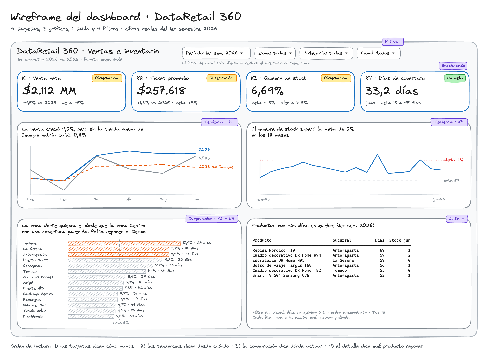
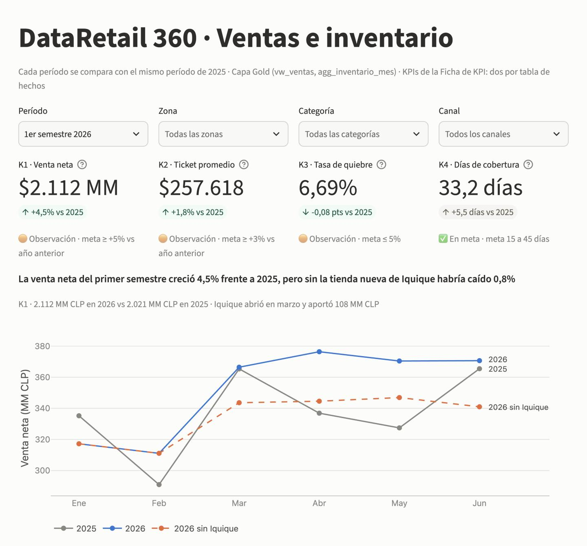
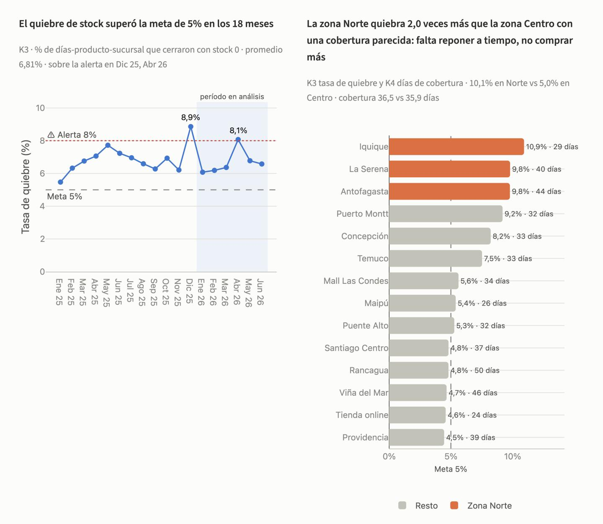
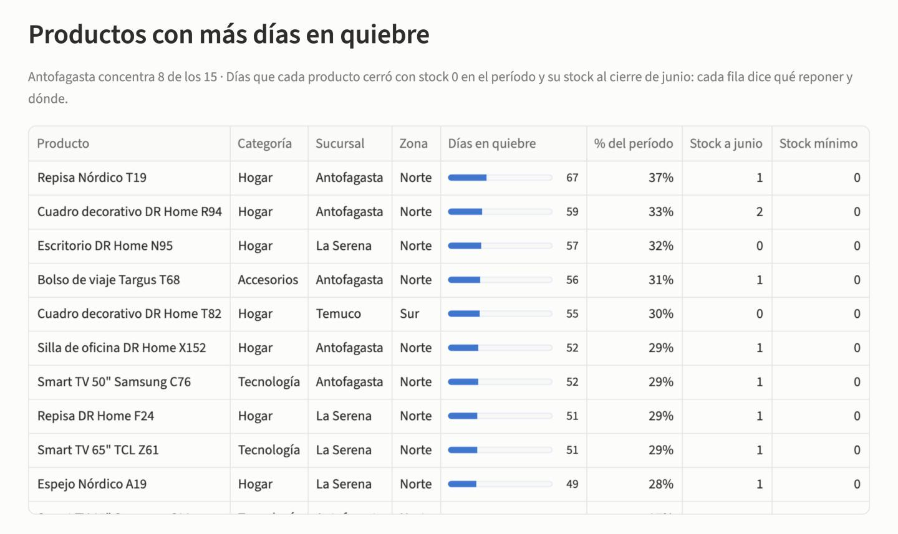
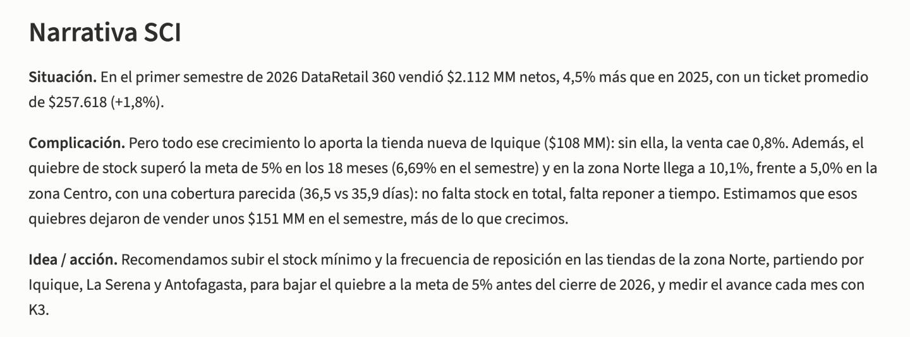
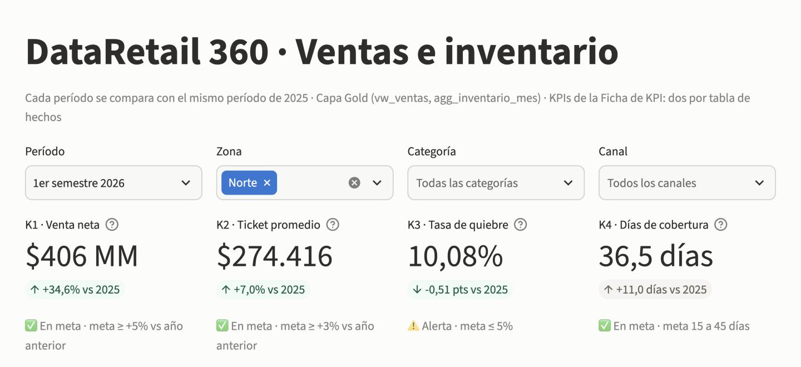

# Dashboard de ventas e inventario · DataRetail 360

El dashboard es una app hecha en Python con Streamlit y gráficos de Plotly (`app.py`). Lee la capa
Gold y muestra los cuatro KPIs de la Ficha de KPI (`docs/Ficha_KPI_DataRetail360.xlsx`).

```bash
streamlit run app.py
```

Lo hicimos en Streamlit porque así el dashboard usa las mismas funciones que el notebook
(`src/storytelling.py`): cada KPI se calcula en un solo lugar y no puede dar un número distinto
en cada parte.



## Qué muestra

| Parte | Qué muestra | Para qué sirve |
|---|---|---|
| Filtros | Período, zona, categoría y canal | Ver el mismo dashboard para una parte del negocio. El filtro de canal solo cambia las ventas, porque el inventario no tiene canal |
| 4 tarjetas | K1 venta neta, K2 ticket promedio, K3 tasa de quiebre y K4 días de cobertura, con la variación contra el año anterior y el estado contra la meta | Saber de un vistazo cómo va el período |
| Venta por mes | Líneas de 2026, 2025 y 2026 sin la tienda nueva de Iquique | Ver si el crecimiento viene de las tiendas que ya existían |
| Quiebre por mes | Línea de los 18 meses con la meta (5%) y la alerta (8%) | Ver desde cuándo el quiebre está sobre la meta |
| Quiebre por sucursal | Barras con la tasa de quiebre y los días de cobertura de cada sucursal | Ver dónde está el problema |
| Productos en quiebre | Tabla con los productos que más días cerraron sin stock | Saber qué producto reponer y en qué sucursal |
| Narrativa | Situación, complicación y acción recomendada | Dejar escrita la conclusión. Solo aparece sin filtros, porque habla de toda la empresa |

## Cómo se ve

Capturas del dashboard funcionando, con el período "1er semestre 2026". La página completa está en
`dashboard/dashboard_completo.png`.

**Filtros, tarjetas de KPI y venta por mes**



**Quiebre de stock por mes y por sucursal**



**Productos con más días en quiebre**



**Narrativa**



**Con el filtro de zona en "Norte"**

Al elegir la zona Norte cambian las cuatro tarjetas y los gráficos: la venta neta queda en $406 MM y
la tasa de quiebre sube a 10,08%, en alerta.



## Por qué está ordenado así

- **Orden.** Arriba va lo general y abajo el detalle: primero las tarjetas, después las tendencias,
  después la comparación entre sucursales y al final la tabla de productos.
- **Tipo de gráfico.** Líneas para lo que cambia en el tiempo, barras horizontales para comparar
  sucursales (los nombres largos se leen bien) y una tabla para el detalle.
- **Color.** Azul para el dato principal, naranjo para lo que queremos destacar como problema
  (la zona Norte y la línea sin Iquique), gris para el contexto y rojo solo para la línea de alerta.
- **Accesibilidad.** El estado de cada KPI va escrito ("En meta", "Observación", "Alerta") y no
  depende solo del color.

## Cifras de control

Con el período "1er semestre 2026" y sin otros filtros, el dashboard muestra:

| KPI | Valor | Comparación | Estado |
|---|---|---|---|
| K1 Venta neta | $2.112.212.190 (≈ $2.112 MM) | 1er sem. 2025: $2.021.370.420 · +4,5% · logro 99,5% de la meta | Observación |
| K2 Ticket promedio | $257.618 | 1er sem. 2025: $253.051 · +1,8% · logro 98,8% de la meta | Observación |
| K3 Tasa de quiebre | 6,69% | 1er sem. 2025: 6,76% · Norte 10,08% · Centro 5,00% | Observación |
| K4 Días de cobertura | 33,2 días (junio 2026) | Norte 36,5 · Centro 35,9 · Online 24,0 | En meta |

Por mes (2026):

| Mes | Venta neta (MM) | Ticket | Quiebre | Cobertura (días) |
|---|---|---|---|---|
| Enero | 317,2 | $244.949 | 6,08% | 38,0 |
| Febrero | 311,1 | $258.151 | 6,19% | 33,6 |
| Marzo | 366,5 | $266.124 | 6,37% | 35,8 |
| Abril | 376,4 | $263.215 | 8,07% | 31,4 |
| Mayo | 370,4 | $254.764 | 6,78% | 34,6 |
| Junio | 370,7 | $257.756 | 6,58% | 33,2 |

Usamos estas cifras para revisar que el dashboard, o cualquier consulta hecha sobre el modelo,
esté mostrando lo correcto.
